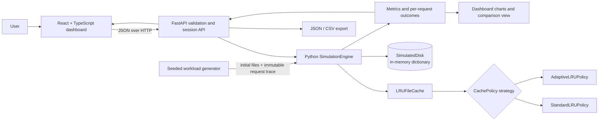

# Architecture

## Component boundaries

- **React dashboard (`frontend/src`)**: captures settings, sends API requests, renders authoritative server state, compares metrics, charts outcomes, and downloads exports. It contains no separate cache implementation.
- **FastAPI (`src/filecache_sim/api.py`)**: validates request schemas, manages in-memory simulation sessions, serializes outcomes/state, exposes health, step/run, comparison, and export routes. Unknown configuration fields are rejected.
- **Workload generator (`src/filecache_sim/workloads.py`)**: creates seeded initial files and a request trace using a private random generator. Workload labels and future operations are not passed to policy hooks.
- **Simulation engine (`src/filecache_sim/simulation.py`)**: executes requests, collects outcomes and metrics, and checks byte-capacity invariants.
- **Cache engine (`src/filecache_sim/cache.py`)**: owns entries, recency, byte accounting, reads/writes/deletes/flush and eviction coordination.
- **Policy strategies (`src/filecache_sim/policies.py`)**: select victims and maintain policy-specific history. Standard LRU is the baseline; adaptive LRU tracks probationary/protected segments and bounded ghost names.
- **Simulated disk (`src/filecache_sim/disk.py`)**: in-memory backing dictionary and logical read/write counters. It never opens host files.
- **Metrics and exports**: engine outcomes feed aggregate counters, API JSON/CSV downloads, and dashboard tables/charts.

## Main request flow

1. The dashboard posts a validated simulation configuration.
2. FastAPI generates the seeded workload and constructs a `SimulationEngine`.
3. Each step calls the same Python engine used by the CLI and tests.
4. The engine updates cache state and simulated-disk counters, and records an outcome.
5. The API returns state and metrics; the UI refreshes views and can request JSON/CSV exports.
6. Paired comparisons reuse the same trace and initial file contents for both policies; a SHA-256 trace fingerprint identifies the trace.
